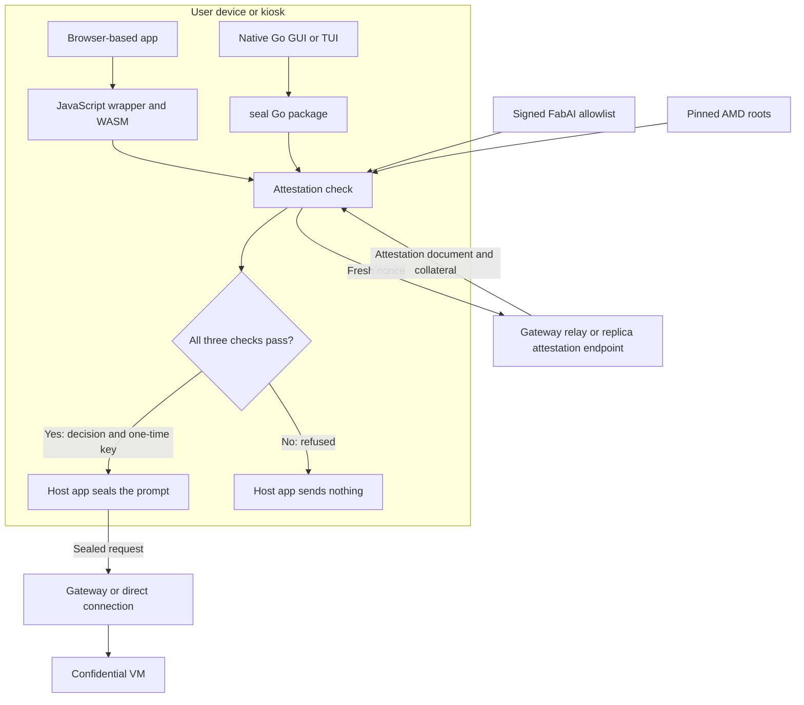

# fabai-attestation-verifier

This repository provides a fail-closed, client-side attestation verifier for
FabAI applications. An integrating application runs the verifier immediately
before each protected AI chat (inference) request. The verifier decides whether
the target confidential virtual machine (VM) is running on genuine hardware
with approved software and the expected GPU evidence. Only a successful check
releases the attested key needed to seal that request.

The verifier is a component, not a complete web app or kiosk interface. It
runs on the user's device and can be integrated as:

- the [`seal`](seal) Go package in a native Go graphical user interface (GUI)
  or text-based user interface (TUI)
- the WebAssembly (WASM) bundle and JavaScript wrapper in a browser-based app
  or kiosk
- the `fabai-seal` command-line interface (CLI) for release gates, diagnostics,
  and saved-document checks

The host application presents the result, seals the prompt, and sends it. This
repository supplies the verification decision and one-time attested key; it
does not supply the surrounding interface, prompt encryption workflow,
gateway, or confidential VM.

## Architecture



Both integration paths run the same Go verification logic locally on the
user's device. A browser app calls it through the JavaScript and WASM wrapper;
a native Go kiosk imports the `seal` package directly. The CLI exposes the
same checks for operational use, but the Go package is the preferred boundary
for a native GUI or TUI.

The verifier makes one network request during each live check: it requests a
nonce-bound attestation document from a `cvmimage` 0.14.x replica, either
directly or through the gateway's relay. AMD roots and the verified FabAI
allowlist are local trust inputs. The document carries the other collateral
needed for offline verification.

## Integration options

### Browser app or browser-based kiosk

Use the WASM bundle and [`js/seal.mjs`](js/seal.mjs). Call
`seal.check({ baseURL, enclave })` before every protected send. The host app
renders the result, seals one request to `hpkeKey`, and sends only when
`permitted` is true.

### Native Go GUI or TUI

Import the [`seal`](seal) package and call `Checker.Check` before every
protected send. The host app renders the `Result`, consumes `SendKey` once,
and then seals and sends the request.

### Automation, release gate, or diagnostics

Use the `fabai-seal` CLI for live or saved-document checks. Act on its exit
status or JSON result. The CLI is not the preferred integration boundary for
a GUI or TUI.

## Verification flow

For every protected send, the verifier:

1. creates a fresh 32-byte nonce and fetches a v3 attestation document from
   `GET /.well-known/tinfoil-attestation/v3?nonce=…`
2. parses the document strictly with `tinfoil-go`'s `verify/document` and
   recomputes `REPORT_DATA` from the nonce and document sections
3. authenticates the SEV-SNP report offline, including its VCEK, ASK, and
   pinned AMD root chain; the AMD certificate revocation list (CRL); the report
   signature; the chip ID; the trusted computing base (TCB); and the
   `REPORT_DATA` binding
4. matches the report against FabAI's signed allowlist
5. checks the GPU evidence, subject to the first-version limitation described
   in [Demonstrator security guarantees](#demonstrator-security-guarantees)
6. returns three checks and a send/no-send decision, releasing the attested
   Host Public Key Encryption (HPKE) key only when all three checks pass

Any failure, error, panic, or timeout produces a refusal and no key, so the host
application must send nothing. The verifier makes no AMD Key Distribution
Service, NVIDIA, Sigstore, or Tinfoil service calls during a check.

## Demonstrator security guarantees

The result contains three ordered checks, shown as ticks on the demonstrator's
main screen.

### Genuine AMD secure hardware

This check passes when:

- a Versioned Chip Endorsement Key (VCEK), not a Versioned Loaded Endorsement
  Key (VLEK), signs the report
- the VCEK chains through the AMD Signing Key (ASK) to the pinned AMD Root Key
  (ARK) for the report's product: Milan, Genoa, or Turin
- that ARK signs the CRL, which is current at check time and lists neither the
  ASK nor the VCEK
- the VCEK's hardware ID and TCB match the report's `CHIP_ID` and
  `REPORTED_TCB`
- the document binds the report's `REPORT_DATA` to this check's nonce, with its
  upper half set to zero
- a verified allowlist is loaded and `REPORTED_TCB` meets its platform minimum

It does not prove anything about the software. It also proves only that the CRL
has not expired according to the device's clock, not that it is the latest CRL
published by AMD.

### Approved software

This check passes when an `active` allowlist entry matches the report's
`MEASUREMENT` and `HOST_DATA`. The guest policy must meet the entry's
constraints, with debugging and the migration agent disabled, and
`REPORTED_TCB` must meet the entry's minimum. The document must also carry the
channel key needed by the client.

It proves that the measured software is approved by the allowlist, not that the
software is free of bugs.

### NVIDIA GPU in secure mode

This check passes when the GPU evidence is bound into `REPORT_DATA` and has:

- exactly the number of `gpu`/`nvidia` items required by the allowlist entry
- a non-empty certificate and evidence in each v1 item
- the entry's expected architecture, currently `BLACKWELL`
- the nonce generated for this check

**The verifier does not yet check the GPU's own Security Protocol and Data Model
(SPDM) signature, NVIDIA certificate chain, or measurements.** This version
trusts the measured guest to have collected the evidence. The experts view
states this limitation.

The ticks depend on each other. If the report can't be authenticated, the
software and GPU ticks are `not_checked`. If the software tick fails, the GPU
tick is `not_checked`. A `not_checked` tick counts as a failure. A
`REPORTED_TCB` below the platform minimum fails the hardware tick, and also
the software tick, because every entry's minimum is at least the platform
minimum.

Each failed tick has a clear and stable reason code ([`reason/reason.go`](reason/reason.go)).

## Native Go integration

Import the `seal` package into the application that owns the native GUI or TUI:

```go
import "github.com/digicatapult/fabai-attestation-verifier/seal"

checker := seal.New(allowlistJSON, allowlistBundleJSON, seal.Options{})
// Before every send:
result := checker.Check(ctx, seal.Target{BaseURL: gatewayURL, Enclave: "protected.fabai.internal"})
if key, ok := result.SendKey(); ok {
    // Seal this one request body to key with EHBP, then drop the key.
}
// result.Ticks, result.Message (main screen), result.Detail (experts view)
```

- `seal.New` checks the allowlist's Sigstore bundle offline. If that fails,
  every check fails with `allowlist_unverified`; `AllowlistError` says why.
- `SendKey` returns the key only when all three ticks pass, and only once.
  Run a new check, with a new nonce, for every request. Don't cache or share
  results, including between concurrent requests.
- `Options.Channel = seal.ChannelTLS` returns the attested TLS SPKI pin
  instead, for native clients connecting directly to a replica;
  `seal.PinnedTLSConfig(pin, host)` builds a TLS config that checks it and
  ignores the certificate's validity (a self-signed replica certificate
  expires an hour after boot).
- `Check` uses the system clock. Nothing in the API sets the clock, the AMD
  roots or the allowlist signer.
- `CheckDocument` checks a saved document against the nonce it was requested
  with.
- `seal.DefaultDeadline` is 15 s, provisional until a check against the
  Protected VM has been timed.

## Browser and WASM integration

The browser integration runs the same Go code, built with
`GOOS=js GOARCH=wasm`. `sigstore-go` doesn't
build for `js/wasm` (its `in-toto-golang` dependency calls `unix.Access`
there), so the WASM build can't check the allowlist's Sigstore bundle.
Instead, the kiosk's bundle build checks it natively and embeds the list, and
the kiosk pins the bundle's SHA-256, which then covers the list:

```sh
scripts/build-wasm.sh dist allowlist.json allowlist.sigstore.json
```

```js
import { loadSeal } from "./seal.mjs"; // after loading wasm_exec.js
const seal = await loadSeal(wasmBytes, PINNED_SHA256);
const result = await seal.check({ baseURL, enclave });
if (result.permitted) { /* seal to result.hpkeKey with ehbp@0.6.0 */ }
```

`loadSeal` throws if the bundle digest does not match `PINNED_SHA256`.

The bundle exports only `check`. The release's WASM embeds no allowlist:
every check with it fails with `allowlist_unverified`.

## Command line

Use the CLI for release gates, diagnostics, and offline checks. Native Go
interfaces should normally import the `seal` package instead of invoking this
command as a subprocess.

```sh
# Live, through the gateway
fabai-seal check --allowlist allowlist.json --bundle allowlist.sigstore.json \
  --url https://gateway.fabai.internal --enclave protected.fabai.internal [--json]

# Offline: a saved document and the nonce it was requested with
fabai-seal check --allowlist allowlist.json --bundle allowlist.sigstore.json \
  --document doc.json --nonce <64 hex> [--json]

# Verify an allowlist, and write it for the kiosk's WASM build
fabai-seal allowlist verify \
  --allowlist allowlist.json --bundle allowlist.sigstore.json [--out file]
```

`check` exits 0 only if sending would be permitted, 1 if not, 2 on a usage
error. No flag sets the clock or the AMD roots, so release gates use a
document captured on the day.

## Allowlist

A JSON file, published as a release asset of
`digicatapult/fabai-allowlist` with a Sigstore attestation from its
`.github/workflows/release.yml` at a `vX.Y.Z` tag; that signer is compiled in
([`internal/allowlist/signer.go`](internal/allowlist/signer.go)). See the
[`example allowlist`](internal/allowlist/testdata/allowlist.json).

- `version`: 1
- `platformMinimumTcb`: `{bootloader, tee, snp, microcode, fmc?}`; `fmc`
  applies to Turin only
- `entries[]`: the measured fields of `fabai-boot-chain`'s `measure-snp`
  `allowlist-entry.json` (`measurement`, `firmware`, `runtimeImage`,
  `cmdline`, `configSha256`, `vmShape`, `guestFeatures`), plus `id`,
  `status` (`active` or `revoked`), `hostData`, `guestPolicy`, `minimumTcb`
  (at least the platform minimum in every component) and `provenance`.
  `vmShape.gpus` and `vmShape.gpuArchitecture` are checked against the GPU
  evidence.

Unknown or duplicate members are refused.

## Conformance vectors

[`vectors/`](vectors) holds one JSON file per vector: the exact document
bytes, the nonce, the allowlist, a fixed check time (CRLs expire), and the
expected ticks and reason codes. The same files run:

- in Go: `go test -tags sealtest ./vectors/`
- in WASM under Node.js, through Go's test runner, using the command in
  [Development](#development)
- in WASM under Node.js, through the JS wrapper: `js/test/run-vectors.mjs`

Synthetic vectors use a fake ARK, ASK and VCEK, with reports signed by
`go-sev-guest`'s test signer and documents built by `document.Build`
(`go run -tags sealtest ./internal/sealtest/gen -out vectors`); they cover
every negative scenario that a document can express. They share one
allowlist, [`vectors/fixtures/synthetic-allowlist.json`](vectors/fixtures),
named by each vector's `allowlistFile` (relative to the vector) in place of
an inline `allowlist`. The generator re-signs every document on each run, so
regenerate only when a scenario changes; a Go test checks that the committed
files still match the generator's scenarios and expectations. Fetch-level scenarios
(503, oversized, redirect, deadline, concurrency, a server swapped between
sends) are Go tests against `httptest` servers. Captured vectors are real
documents from a public `cvmimage` 0.14.19 deployment. Capture them with
`go run -tags sealtest ./internal/sealtest/capture …`.

The `sealtest` build tag adds the hooks the vectors need (fake roots, a fixed
clock, an unsigned allowlist). Release builds don't have it, and
[`internal/releasecheck`](internal/releasecheck) checks that their binaries
don't contain it.

## Testing an integration

The [`sealtest`](sealtest) package, also built only with the `sealtest` tag,
lets another project test its use of the seal check without SEV-SNP
hardware: for example a gateway that relays attestation requests, a client
that seals requests to the attested key, or a service that supplies AMD
collateral.

```go
replica, err := sealtest.NewReplica(hpkePublicKey) // the test server's X25519 key
defer replica.TrustRoots()()                       // trust the synthetic AMD root
doc, err := replica.Approved(nonce)                // or replica.Modified(nonce)
result := sealtest.Checker(seal.Options{}).Check(ctx, target)
```

- `Approved` documents pass all three ticks. `Modified` documents pass the
  hardware tick and fail the software tick.
- `ApprovedWithCollateral` builds a document with a collateral service's
  entries in place of the replica's own.
- `VCEK`, `CertChainPEM`, `CRL`, `ChipID` and `ReportedTCB` give a
  collateral service the synthetic chain to cache.
- `TrustRoots` replaces the pinned AMD roots for the whole process, so don't
  run checks in parallel with tests that rely on AMD's roots.

Put such tests in files with a `//go:build sealtest` constraint, and run them
with `go test -tags sealtest`.

## Development

Go 1.27.4 (`tinfoil-go` uses `encoding/json/v2`), Node.js for the WASM tests.
A DevContainer template exists under `.devcontainer` for convenience, with
a matching Go version, Node.js v24, and ShellCheck.

```sh
go test ./... && go test -tags sealtest ./...
PATH="$(go env GOROOT)/lib/wasm:$PATH" GOOS=js GOARCH=wasm \
  go test -tags sealtest ./vectors/
scripts/check-reproducible.sh   # the WASM rebuilds to the same SHA-256
```

| Path                                                      | What                                                                        |
| --------------------------------------------------------- | --------------------------------------------------------------------------- |
| [`seal/`](seal)                                           | Public API: `Checker`, `Result`, ticks, main-screen wording, experts detail |
| [`reason/`](reason)                                       | Reason codes                                                                |
| [`internal/fetch`](internal/fetch)                        | Nonce and document request                                                  |
| [`internal/docbind`](internal/docbind)                    | The one adapter over `verify/document`                                      |
| [`internal/amd`](internal/amd)                            | Pinned roots, report authentication, offline CRL, TCB                       |
| [`internal/allowlist`](internal/allowlist)                | Schema, Sigstore check, match                                               |
| [`internal/gpu`](internal/gpu)                            | First-version GPU checks                                                    |
| [`cmd/fabai-seal`](cmd/fabai-seal)                        | CLI                                                                         |
| [`cmd/fabai-seal-wasm`](cmd/fabai-seal-wasm), [`js/`](js) | WASM entry point and JS wrapper                                             |
| [`internal/sealtest`](internal/sealtest)                  | Vector format, runner, synthetic generator, capture tool (`sealtest` tag)   |
| [`sealtest/`](sealtest)                                   | Synthetic documents for testing integrations (`sealtest` tag)               |

## Licence

AGPL-3.0, because of `tinfoil-go`'s `verify/` directory. See
[`NOTICE.md`](NOTICE.md).
